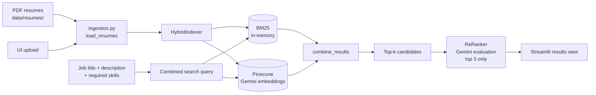

# 🎯 HireFlow

**AI-powered resume search and candidate matching.**

HireFlow lets a recruiter paste in a job title, description and required skills, then searches a pool of PDF resumes using **hybrid retrieval** (BM25 keyword search + Pinecone vector search with Gemini embeddings). The top candidates are then assessed by an LLM, which produces strengths, gaps, risks and a fit score. The whole thing runs as a [Streamlit](https://streamlit.io/) app built on [LangChain](https://www.langchain.com/).

> **Status:** work in progress. The core pipeline runs end to end, but the code contains a set of known, documented shortcomings (see [Known Limitations](#known-limitations)).

---

## Table of Contents

- [Features](#features)
- [How It Works](#how-it-works)
- [Tech Stack](#tech-stack)
- [Project Structure](#project-structure)
- [Getting Started](#getting-started)
- [Configuration](#configuration)
- [Usage](#usage)
- [Module Reference](#module-reference)
- [Sample Data](#sample-data)
- [Known Limitations](#known-limitations)
- [Security Notes](#security-notes)
- [License](#license)

---

## Features

- **PDF resume ingestion**: loads resumes from `data/resumes/` at startup, and accepts new PDF uploads through the UI.
- **Hybrid search**: combines an in-memory BM25 index (keyword) with a Pinecone index (semantic) built on Google `gemini-embedding-001` embeddings.
- **Job-description-driven queries**: job title, description and required skills are combined into a single search query.
- **LLM candidate evaluation**: the top 3 results get an AI assessment (strengths, gaps, risks, summary, fit score) from Gemini via `ReRanker`. If no LLM is available it falls back to a rule-based evaluation.
- **Search router**: classifies queries as *shallow* (vector-only) or *deep* (hybrid + LLM re-rank), using `RunnableBranch`.
- **Multi-query generator**: expands one query into several (LLM-based, with a rule-based fallback).
- **Session memory dashboard**: tracks search history and candidate interactions.
- **RAGAS evaluation dashboard**: scores search quality with answer relevancy, context precision, faithfulness and answer correctness.
- **Shared rate limiter**: a single LangChain `InMemoryRateLimiter` shared by every LLM call, so the app queues requests instead of failing with 429s on the Gemini free tier (default: 5 requests/minute).

---

## How It Works



**Startup**
1. `SystemManager` creates the `VectorStore` (Pinecone client, index, Google embeddings).
2. If Pinecone is reachable, it builds a `HybridIndexer` and `SearchRouter`, along with the `ResumeParser`, `JobParser`, `ReRanker` and `MemoryRAG`.
3. Every PDF in `data/resumes/` is loaded, indexed into BM25 and embedded into Pinecone.
4. All of this is wrapped in `@st.cache_resource`, so it runs once per server process rather than on every Streamlit rerun.

**Search**
1. The form fields are merged into one query string.
2. `HybridIndexer.search_resumes()` scores every resume with BM25 and queries Pinecone (filtered to `type = "resume"`).
3. Results are merged, sorted and truncated to `top_k`.
4. The top 3 candidates are sent to `ReRanker.evaluate_candidate()` for an AI evaluation, shown in the results expanders.

> `SearchRouter` (shallow/deep routing and LLM re-ranking) is currently used only by the **RAGAS evaluation** page. The main search page calls `HybridIndexer` directly.

---

## Tech Stack

| Area | Technology |
|---|---|
| UI | Streamlit |
| Orchestration | LangChain (`langchain-core`, `langchain-classic`, `langchain-text-splitters`, `langchain-community`) |
| LLM | Google Gemini via `langchain-google-genai` (default `gemini-3.5-flash-lite`) |
| Embeddings | Google `models/gemini-embedding-001` (768 dimensions by default) |
| Vector DB | Pinecone serverless (AWS `us-east-1`, cosine metric) |
| Keyword search | `rank-bm25` (BM25Okapi) |
| Validation / config | Pydantic v2, `pydantic-settings`, `python-dotenv` |
| PDF parsing | `pypdf` (through LangChain's `PyPDFLoader`) |
| Evaluation | RAGAS 0.4.x |
| Data | pandas |

Developed with **Python 3.12**.

---

## Project Structure

```
HireFlow/
├── streamlit/
│   └── app.py              # Streamlit UI and SystemManager (main entry point)
├── core/
│   ├── ingestion.py        # PDF → LangChain Document loading (resumes & JDs)
│   ├── parsing.py          # LLM-based ResumeParser / JobParser (Pydantic output)
│   ├── vector_store.py     # Pinecone index management, embedding, similarity search
│   ├── hybrid_indexer.py   # BM25 + vector retrieval and result merging
│   ├── search_router.py    # Shallow/deep routing + LLM re-ranking (RunnableBranch)
│   ├── re_ranker.py        # LLM candidate evaluation + rule-based fallback
│   ├── memory_rag.py       # Session memory: search history & candidate views
│   ├── evaluator.py        # RAGAS-based search-quality evaluation
│   └── filters.py          # (empty placeholder)
├── utils/
│   ├── config.py           # Settings loaded from environment / .env
│   ├── schemas.py          # Pydantic models: Resume, JobDescription, CandidateEvaluation
│   ├── utils.py            # Logging, text cleaning, PDF loading, rate limiter,
│   │                       #   embeddings factory, metadata filter helpers
│   └── multi_query.py      # Multi-query generator
├── data/
│   ├── resumes/            # 50 sample PDF resumes
│   ├── jds/                # Job descriptions (empty)
│   ├── hybrid_index/       # (empty)
│   └── memory/             # (empty)
├── main.py                 # (empty placeholder)
├── requirements.txt
└── .gitignore
```

---

## Getting Started

### Prerequisites

- Python 3.12 (recommended)
- A **Google AI Studio API key**, for Gemini chat and embeddings: <https://aistudio.google.com/>
- A **Pinecone API key**: <https://www.pinecone.io/>

### Installation

```bash
# 1. Clone the repository and enter it
git clone <your-repo-url> HireFlow
cd HireFlow

# 2. Create and activate a virtual environment
python -m venv .venv
source .venv/bin/activate        # Windows: .venv\Scripts\activate

# 3. Install dependencies
pip install -r requirements.txt
```

### Configure environment variables

Create a `.env` file in the project root:

```env
GOOGLE_API_KEY=your-google-api-key
PINECONE_API_KEY=your-pinecone-api-key

# Optional (defaults shown)
PINECONE_INDEX_NAME=hireflow
PINECONE_DIMENSION=768
LLM_MODEL=gemini-3.5-flash-lite
LLM_REQUESTS_PER_MINUTE=5
```

### Run the app

Run from the **project root** (settings and data paths are resolved relative to it):

```bash
streamlit run streamlit/app.py
```

On the first launch, HireFlow creates the Pinecone index if it doesn't exist (this includes a built-in wait of about 10 seconds), then embeds and indexes all PDFs in `data/resumes/`. Expect this to take a while, especially on free-tier quotas.

---

## Configuration

Settings are defined in `utils/config.py` and read from environment variables or `.env`.

| Variable | Required | Default | Description |
|---|---|---|---|
| `GOOGLE_API_KEY` | ✅ | – | Google AI Studio key, used for Gemini chat models and embeddings |
| `PINECONE_API_KEY` | ✅ | – | Pinecone API key |
| `PINECONE_INDEX_NAME` | | `hireflow` | Name of the Pinecone index |
| `PINECONE_DIMENSION` | | `768` | Embedding / index dimension. Embeddings are requested at this size |
| `PINECONE_METRIC` | | `cosine` | Pinecone similarity metric |
| `LLM_MODEL` | | `gemini-3.5-flash-lite` | Gemini model used for parsing, routing, re-ranking and evaluation |
| `LLM_REQUESTS_PER_MINUTE` | | `5` | Global LLM request budget for the shared rate limiter (set to match your API tier) |

> ⚠️ **Changing `PINECONE_DIMENSION` on an existing index will delete and recreate that index**, destroying all stored vectors (see [HW5](#known-limitations)). Use a new `PINECONE_INDEX_NAME` instead if you want to keep existing data.

---

## Usage

### Main page

| Section | What it does |
|---|---|
| **Add Resumes** | Upload one or more PDF resumes. They are saved into `data/resumes/` and added to the index. |
| **Search Candidates** | Enter a job title, description, required skills (one per line) and the number of results (3–10), then click **Find Candidates**. |
| **Results** | Each candidate appears in an expander with a score, resume preview and, for the top 3, an AI evaluation. |
| **Sidebar** | Shows system status, the number of indexed resumes and memory stats. |

### 📊 Memory & Evaluation page

- **Search memory**: counts of interactions, searches and candidate views, plus recent search history.
- **RAG quality evaluation**: enter a query and expected skills, and RAGAS scores the retrieval.

> **Cost warning:** each evaluation runs 4 RAGAS metrics per result, and each metric makes several LLM calls. At 5 requests/minute a single evaluation with `top_k=5` can take many minutes. Start with a small `top_k`.

---

## Module Reference

| Module | Key classes / functions | Purpose |
|---|---|---|
| `core/ingestion.py` | `load_resumes()`, `load_job_descriptions()`, `DocumentProcessor` | Turn PDFs into `Document` objects with basic metadata (`candidate_id`, `name`, `filename`, `source`). |
| `core/parsing.py` | `ResumeParser`, `JobParser` | LLM + `PydanticOutputParser` extraction of structured resume / JD data. |
| `core/vector_store.py` | `VectorStore` | Index creation, embedding, upserts, similarity search, metadata-filter translation. |
| `core/hybrid_indexer.py` | `HybridIndexer` | Builds BM25 indexes and merges keyword and vector results. |
| `core/search_router.py` | `SearchRouter` | Routes queries to shallow (vector) or deep (hybrid + LLM re-rank) search. Modes: `auto`, `shallow`, `deep`. |
| `core/re_ranker.py` | `ReRanker` | LLM evaluation of candidate vs. job, with a rule-based fallback. |
| `core/memory_rag.py` | `MemoryRAG` | Records searches and candidate views for the session. |
| `core/evaluator.py` | `RAGEvaluator` | RAGAS metrics, evaluation history, CSV export. |
| `utils/utils.py` | `get_rate_limiter()`, `get_embeddings()`, `apply_filters()`, … | Shared helpers: text cleaning, PDF loading, rate limiting, embeddings, skill/location/experience filters. |
| `utils/multi_query.py` | `MultiQueryGenerator` | Query expansion. Not yet wired into the app. |
| `utils/schemas.py` | `Resume`, `JobDescription`, `CandidateEvaluation` | Pydantic data models. |

### Data models

```python
Resume(candidate_id, name, email?, phone?, location?, text, skills[], experience?)
JobDescription(jd_id, title, text, required_skills[], optional_skills[], min_experience?, location?)
CandidateEvaluation(candidate_id, fit_score: 0–100, strengths[], gaps[], risks[], summary, evidence{})
```

---

## Sample Data

`data/resumes/` contains **50 synthetic PDF resumes** named `First_Last_Resume_NN.pdf`, all for accounting and finance roles (Staff Accountant, Senior Accountant, Financial Analyst, Tax Manager, Controller and similar). Every resume follows the same layout: contact info (including a `Location:` line), `PROFESSIONAL SUMMARY`, `TECHNICAL SKILLS`, `SOFTWARE PROFICIENCY`, `PROFESSIONAL EXPERIENCE` and `EDUCATION`. 35 of the 50 also have a `CERTIFICATIONS` section.

This consistent layout makes rule-based metadata extraction (skills and location) feasible without an LLM call per resume.

Two things to be aware of:

- All 50 PDFs contain an unrendered template placeholder, `{generate_achievements(experience_years)}`, in the **ACHIEVEMENTS** section. This is a data-generation bug and shows up in the indexed text.
- The resumes aren't real people, but treat any resume data you add with appropriate care (see [Security Notes](#security-notes)).

---

## Known Limitations

The source contains numbered `TODO: HWn` comments marking known issues and planned improvements. The main ones, grouped by theme:

**Retrieval quality**

| Item | Issue |
|---|---|
| HW1, HW9 | Resume `Document`s carry no real skills, experience or location. BM25 results report placeholder values (`location='Unknown'`, `experience=5`, empty skills). |
| HW7 | "Hybrid" scoring sorts raw BM25 scores (unbounded) together with cosine scores (0–1), so keyword results dominate. Reciprocal Rank Fusion is the planned fix. |
| HW8 | The same candidate can appear twice, because BM25 and vector results use different IDs. |
| HW10, HW11 | Zero-score BM25 results pad the list, and tokenization keeps punctuation and stopwords. |
| HW2 | Queries are embedded with `embed_documents()` instead of `embed_query()`. |
| HW15, HW29 | Filters (including the required-skills field) are collected or accepted but never applied. `apply_filters()` is unused. |

**Indexing & vector store**

| Item | Issue |
|---|---|
| HW3 | One embedding API call per resume instead of batching. |
| HW4 | Resumes and job descriptions share one Pinecone namespace. |
| HW5 | A dimension mismatch **deletes and recreates the index**. |
| HW6 | Vector IDs include list position, so re-indexing in a different order creates duplicates. |
| HW12 | Indexing a new resume replaces the in-memory BM25 index instead of appending to it. |

**LLM components**

| Item | Issue |
|---|---|
| HW13 | The search route is decided twice per search (two LLM calls). |
| HW14 | The LLM re-ranker sees only names and scores, not resume content. |
| HW16, HW17 | The fit score formula yields near-identical scores for every candidate, and the "gaps" section is never parsed correctly. |
| HW18 | `ResumeParser` asks the LLM to echo the entire resume back in its JSON output. |
| HW19 | `MultiQueryGenerator` drops the original query from its output. |
| HW25 | Placeholder candidate details (email, phone, 5 years' experience) are sent to the AI evaluator. |
| HW31 | `parse_resume()` is called on each upload and its result is discarded. |

**UI, memory & evaluation**

| Item | Issue |
|---|---|
| HW20, HW21, HW22 | The RAGAS evaluation judges a template string rather than real output, failed scores show as `0.00`, and there's no up-front cost estimate. |
| HW23 | `ConversationBufferMemory` is deprecated. |
| HW26, HW27 | The AI fit score (0–100) is displayed as `/10`, and the RAGAS overall score (0–1) is compared against a 0–10 scale. |
| HW28 | Searches are recorded twice, and the top 3 results are logged as "viewed" automatically. |
| HW30 | If Pinecone is unavailable, search is disabled entirely, even though BM25 needs no Pinecone. |

**Other notes**

- `main.py` and `core/filters.py` are empty placeholders.
- `load_job_descriptions()` and `MultiQueryGenerator` exist but aren't used by the app, and `data/jds/` is empty.
- BM25 indexes live in memory only, so they are rebuilt on every server restart. `data/hybrid_index/` is unused.

---

## Security Notes

- **Never commit `.env`.** It is already listed in `.gitignore`. If API keys were ever shared or committed, rotate them in Google AI Studio and the Pinecone console.
- Resumes contain personal data (names, emails, phone numbers). Uploaded resumes are stored in `data/resumes/` and their full text is stored as metadata in Pinecone, so consider access controls and data-retention rules before using real candidate data.
- Resume text is sent to Google's Gemini API for embedding, parsing and evaluation.

---

## License

No license has been specified yet. Add a `LICENSE` file before publishing or distributing this project.
